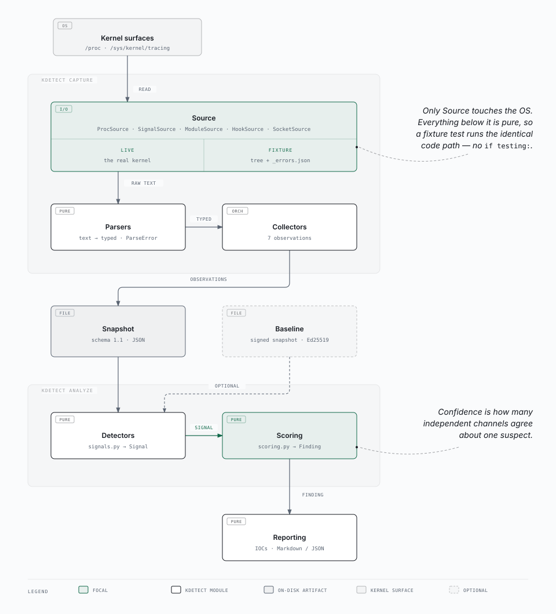

# kdetect

[](https://github.com/basil9099/kdetect/actions/workflows/tests.yml)
[](https://github.com/basil9099/kdetect/actions/workflows/lint.yml)
[](https://github.com/basil9099/kdetect/tree/python-coverage-comment-action-data)
[](pyproject.toml)
[](LICENSE)
[](https://basil9099.github.io/projects/kdetect/)

Linux kernel rootkit detection via cross-view comparison.

**TL;DR:** A rootkit is malware that hides itself by tampering with what the
operating system reports, so tools like `ps` and `lsmod` stop showing it. kdetect
asks the kernel the same question through several independent channels and flags
any place where the answers disagree. On a lab VM it caught a real rootkit,
[Diamorphine](https://github.com/m0nad/Diamorphine), and a hidden ftrace-hooking
kernel module, both at HIGH confidence.


Recorded on the lab VM (Debian 12, kernel 6.1.0-52) with kdetect's own benign test
module, [`kmod/kdetect_hooktest.c`](kmod/kdetect_hooktest.c). Pauses are shortened:
each capture's syscall sweep takes about a minute. [`tools/demo.sh`](tools/demo.sh)
reproduces the run.

## Highlights

- **Tested against a live rootkit.** It caught Diamorphine and a self-hiding test
  module live as root on a VM. Those captures are committed and re-checked on
  every CI run.
- **Evidence you can check.** Each finding names the channels that saw something
  and the channel that denied it. The README says which results were shown live
  and which only with synthetic inputs.
- **Mapped to MITRE ATT&CK.** Findings map to T1014 Rootkit and T1547.006 Kernel
  Modules and Extensions.
- **Tamper-evident baselines.** Snapshots of a clean host can be signed with
  ed25519, and kdetect checks the signature before it reads the file.
- **Limits written down.** 30 numbered limitations, each traced to captured
  evidence.
- **Tested in CI.** Unit, analysis and integration tests, with lint and coverage
  checks on every push.

<details>
<summary><b>New to kernel security? A short glossary</b></summary>

- **Rootkit**: malware built to hide its own presence (processes, files, kernel
  modules) by tampering with what the system reports.
- **Kernel module**: code loaded into the running Linux kernel, with full
  privilege. Kernel rootkits are usually modules that then hide themselves.
- **`/proc`**: a virtual filesystem through which the kernel exposes running
  processes and loaded modules. `ps` and `lsmod` read it, which makes it the
  thing a rootkit filters first.
- **Cross-view detection**: asking the same question through two independent
  routes and treating disagreement as the finding.
- **ftrace**: the kernel's built-in function-tracing framework. Rootkits abuse it
  to hook kernel functions, but it records which module owns each hook.
- **Taint flags**: bits the kernel sets for good when, for example, an unsigned
  or out-of-tree module loads. They stay set after the module hides.
- **vmalloc**: the kernel memory area module code is loaded into. A hidden module
  still occupies a region there.

</details>

## How cross-view detection works

A rootkit hides by lying to whoever asks. kdetect asks the same question through
several channels that a rootkit has to subvert separately, records every answer,
and reports where they diverge.

A hidden process is the clearest case. `/proc` readdir is the listing everything
uses, and it is exactly what a process-hiding rootkit filters. So kdetect does not
trust it alone:

- **readdir**: walk `/proc` twice, recording what the listing offers
- **syscall**: sweep every possible task id with `kill(pid, 0)`, which answers
  from the kernel's task table rather than the directory
- **direct read**: read `/proc/<tid>/status`, bypassing the listing again
- **sockets**: attribute open sockets to owning pids through `/proc/<pid>/fd`

A pid confirmed by the syscall sweep, a direct read, and a socket owner, but
absent from the readdir listing, is hidden. One channel alone is LOW confidence;
three independent channels agreeing is HIGH. The same shape applies to modules:
`/proc/modules` is the listing, while kernel taint bits, unaccounted vmalloc
regions, and ftrace hook ownership are channels a module must suppress separately.

## Install

Requires Python 3.11+. One runtime dependency, `cryptography`, used for ed25519
baseline signatures.

```bash
pip install -e .
```

`kdetect capture` needs a live `/proc`, so it runs on Linux only. `analyze`,
`report` and `redact` work on a captured JSON file on any platform, so you can
capture on the suspect host and analyse somewhere you trust.

## Try it

The repository ships real captures from a lab VM, so the example below runs with
no VM and no root. `infected-hooktest.json` was taken while a purpose-built kernel
module was loaded and hiding itself, and every process command line in it has been
replaced by `kdetect redact`. The three older fixtures predate that command and
keep their command lines, with session tokens scrubbed in place;
`tests/unit/test_analyze.py` asserts none of them carries a live token.

```bash
kdetect analyze tests/fixtures/snapshots/infected-hooktest.json
```

```
  procfs.modules   trust=LOW   status=OK   74 entities   0ms
                     listed=74
  kernel.module_evidence   trust=MEDIUM   status=OK   0 entities   93ms
                     ftrace_available=True  ftrace_module_count=70  load_module_regions=75  taint=12288
  kernel.hooks   trust=MEDIUM   status=OK   1 entities   71ms
                     enabled_functions_available=True  hooks=1  kallsyms_available=True  kprobes_available=True

findings:
  [HIGH]   hidden_module   module kdetect_hooktest
           seen by: taint, unexpected_hook, vmalloc_region
           denied by: procfs.modules listing
```

Three channels named the module and the listing denied it: 75 module regions in
vmalloc against 74 listed, and taint bits 12 and 13 set with no listed module
accounting for them.

`infected-diamorphine.json` is the same check against a real rootkit,
[Diamorphine](https://github.com/m0nad/Diamorphine), and gives a `HIGH`
`hidden_module` seen by `ftrace_orphan`, `taint` and `vmalloc_region`.

<details>
<summary>For a shareable artifact rather than terminal triage: <code>kdetect report</code></summary>

```bash
kdetect report tests/fixtures/snapshots/infected-hooktest.json
```

````markdown
## Summary
- HIGH: 1 · MEDIUM: 0 · LOW: 0
- Verdict: 1 finding(s) — hidden_module. Investigate.

## Findings
### [HIGH] hidden_module — `module kdetect_hooktest`
- Seen by: taint, unexpected_hook, vmalloc_region
- Denied by: procfs.modules listing
```text
module kdetect_hooktest is concealed from /proc/modules but named by taint, unexpected_hook, vmalloc_region
taint: [{'taint': 12288, 'listed_taint_markers': 0, 'bits': [12, 13]}]
unexpected_hook: [{'function': '__x64_sys_newuname', 'hook_type': 'ftrace', 'callback': 'kdetect_callback', 'owner_module': 'kdetect_hooktest'}]
vmalloc_region: [{'load_module_regions': 75, 'listed': 74, 'unaccounted': 1}]
```

## Indicators of Compromise
- hooked_function: `__x64_sys_newuname` (HIGH)
- kernel_module: `kdetect_hooktest` (HIGH)
````

The report concludes nothing of its own. It presents what `analyze` found, and
every line traces back to a finding or a recorded fact. Anything taken from the
snapshot, such as a module name the rootkit chose, appears as code, so it cannot
turn into a link, formatting or a terminal escape sequence. IOCs are the portable
indicators worth carrying to another host: a module name, a hooked syscall, a C2
endpoint, a process name. Host-local artifacts like pids and inodes stay as
context.

</details>

## What it detects

Eleven of the thirteen numbered detection methods are implemented, documented
individually in [`docs/detection-methods.md`](docs/detection-methods.md). One more
is implemented as a constraint on what kdetect can read, and one is planned.

| Finding | Channels that must disagree |
|---|---|
| `hidden_process` | `syscall_kill`, `direct_status`, `socket_visible` vs `/proc` readdir |
| `hidden_module` | `taint`, `vmalloc_region`, `ftrace_orphan`, `unexpected_hook` vs `/proc/modules` |
| `suspected_hidden_module` | anonymous indicators that fire but name no module |
| `over_listed_module` | `/proc/modules` listing vs `ftrace_modules`, `kallsyms_modules` |
| `baseline_drift` | a module present now but absent from a signed baseline |

Confidence is corroboration count, scoped per suspect: one channel is LOW, two
MEDIUM, three or more HIGH. Baselines are ordinary snapshots plus a detached
ed25519 signature, verified before parsing.

How far each finding has been tested is in
[What has been demonstrated](#what-has-been-demonstrated) below.

### MITRE ATT&CK

Findings mapped to [ATT&CK v19.2](https://attack.mitre.org/) Enterprise.

| Finding | Technique (tactic) |
|---|---|
| `hidden_module` | [T1014 Rootkit](https://attack.mitre.org/techniques/T1014/) (Stealth); [T1547.006 Kernel Modules and Extensions](https://attack.mitre.org/techniques/T1547/006/) (Persistence, Privilege Escalation) |
| `suspected_hidden_module` | T1014 Rootkit (Stealth); T1547.006 Kernel Modules and Extensions (Persistence, Privilege Escalation) |
| `hidden_process` | T1014 Rootkit (Stealth) |
| `baseline_drift` | T1547.006 Kernel Modules and Extensions (Persistence, Privilege Escalation) |
| `over_listed_module` | T1014 Rootkit (Stealth) |

<details>
<summary>Coverage caveats</summary>

A module that stays listed produces no finding unless a signed baseline predates
it, so kdetect sees T1547.006 only when the module hides or is new since the
baseline. T1014 also covers user-mode rootkits, which kdetect has not been tested
against, and hypervisor or firmware rootkits, which sit below anything kdetect can
observe.

</details>

## What has been demonstrated

There are three levels of evidence. **Live** means it ran as root on the lab VM
(Debian 12, kernel 6.1.0-52) with the rootkit actually loaded. **Replayed** means
that live capture is committed and re-analysed on every CI run by
[`tests/unit/test_ground_truth.py`](tests/unit/test_ground_truth.py).
**Synthetic** means hand-built inputs only.

| Claim | Evidence | Real capture |
|---|---|---|
| Clean host gives zero findings | Live, replayed | `clean-phase2.json`, `clean-phase3a.json` |
| `hidden_module` catches Diamorphine at `HIGH` | Live, replayed | `infected-diamorphine.json` |
| `hidden_module` catches a hidden ftrace-hook module at `HIGH` | Live, replayed | `infected-hooktest.json` |
| `hidden_process` | Synthetic only: Diamorphine's process hiding did not engage on 6.1 (L16, L24) | none |
| `suspected_hidden_module`, `baseline_drift` | Synthetic only | none |
| `over_listed_module` | Synthetic: a phantom row injected into a real capture | `infected-hooktest.json`, modified |

Each infected capture was taken in the same boot as its clean partner, so the
loaded module is the only difference between them. Every live run used one kernel.
[`docs/validation.md`](docs/validation.md) has the per-run record (dates, what was
loaded, exact results, what did not engage) and the test behind each row.

### Reproducing

1. **Replay, any OS, no root:** `pytest tests/unit/test_ground_truth.py`
2. **Inspect the captures:** run `kdetect analyze` on any file in
   `tests/fixtures/snapshots/`, as in [Try it](#try-it). The clean captures exit 0
   and the infected ones exit 3 with the finding above.
3. **Re-run live:** build the VM from [`docs/lab-setup.md`](docs/lab-setup.md),
   then run [`tools/demo.sh`](tools/demo.sh) for the test module. Diamorphine's
   procedure is in
   [`docs/step0-phase2/README.md`](docs/step0-phase2/README.md); its source is
   not in this repository.

## What it cannot detect

[`docs/limitations.md`](docs/limitations.md) records 30 numbered limitations, each
one traced to captured evidence under `docs/step0*/` rather than asserted. The
shape of them:

- **A rootkit that hides from every channel is invisible.** Cross-view finds
  inconsistency, not malice. A rootkit that patches all views coherently, or one
  operating below where kdetect can look, produces no disagreement and no finding.
- **kdetect runs on the machine it is inspecting**, parsing input a kernel-level
  attacker can influence, so a sufficiently privileged rootkit can lie to it.
  On-host signing bounds this but does not solve it; off-host verification is
  phase 5.
- **Some evidence needs root**, and some is unavailable regardless: a hidden
  process's `exe` and `cmdline` cannot be recovered, because the collector that
  records them is the readdir path the rootkit suppressed (L26).

## Architecture



Two pure pipelines sit above one impure layer. `Source` is the only code that
touches the operating system, and a collector receives its source as an argument
rather than constructing one, so a fixture-driven test exercises the identical
code path as a live capture. Everything below that seam is pure: parse, collect,
detect, score, render.

The layout follows three principles from
[`docs/architecture.md`](docs/architecture.md): snapshots hold evidence and never
conclusions (P1), disagreement between collectors stays representable rather than
resolved at capture time (P2), and every finding names both the channels that saw
a thing and the channel that denied it. The full reasoning and the snapshot format
are in that document.

## How this was built

I built kdetect as a learning project, with Claude Code (Anthropic's coding agent)
writing most of the implementation. I started out writing the code myself with
Claude Code coaching, but I was new to Python and kept getting stuck on syntax,
which taught me nothing about kernels. The kernel side of this project lives in the
design and in how `/proc` behaves, so early in phase 1 I changed the arrangement.
From then on Claude Code wrote the code and tests, and I read and reviewed each
change before committing it.

The split:

- Me: project scope, the design decisions, and the lab. Claude Code proposed
  options during each phase's design and I picked between them. I rebuilt the lab
  VM from a signature-verified Debian installer, and its `sudo` needs a password,
  so every root capture, rootkit load and live validation was run by me.
- Claude Code: most of the Python and tests, first drafts of the docs, and
  unprivileged checks on the VM over SSH.

Every phase followed the same steps: a brainstorm, a design spec, an implementation
plan, then a task-by-task build, with each task and then the whole branch reviewed
before merging. The specs and plans are in [`docs/superpowers/`](docs/superpowers/),
named after the [superpowers](https://github.com/obra/superpowers) Claude Code
plugin that runs that workflow.

Several problems only showed up on the real VM or in review:

- The parser for ftrace's `enabled_functions` was written against a guessed
  format. A live capture showed each hook on a single line with its owning module
  inline, and the parser was rewritten.
- `hidden_socket` fired on a clean VM, on a VMware Tools vsock socket and a D-Bus
  socket. Some socket families have no `/proc/net` table at all, so the signal was
  removed (L25).
- The phase 4a branch review found that socket owners were compared as thread ids
  against a list of process ids. On a clean host, every thread of a socket-owning
  daemon would have been reported as a hidden process.

## Documentation

- [Write-up](https://basil9099.github.io/projects/kdetect/): the build story,
  from first capture to catching a live rootkit in a contradiction
- [`docs/architecture.md`](docs/architecture.md): how it is put together
- [`docs/detection-methods.md`](docs/detection-methods.md): what it detects and why
- [`docs/validation.md`](docs/validation.md): what has been shown live, what
  only synthetically, and how to reproduce it
- [`docs/limitations.md`](docs/limitations.md): what it cannot detect
- [`docs/threat-model.md`](docs/threat-model.md): who it is defending against
- [`docs/lab-setup.md`](docs/lab-setup.md): building the lab VM

## Commands

<details>
<summary>Full command reference and exit codes</summary>

- `kdetect capture [--out PATH] [--pretty]`: snapshot the live system to a
  JSON file (default: a generated name under `captures/`).
- `kdetect analyze <snapshot> [--json] [--baseline PATH --verify-key PATH]`:
  summarise a snapshot's findings on the terminal; exits 3 if any are present.
- `kdetect baseline <snapshot> --out PATH --sign-key PATH`: sign a clean
  snapshot as a baseline for future drift detection.
- `kdetect report <snapshot> [--format md|json] [--out PATH] [--baseline PATH --verify-key PATH]`:
  render a shareable Markdown or JSON report of a snapshot's findings and
  indicators of compromise; exits 3 if any findings are present.
- `kdetect redact <in.json> <out.json>`: scrub a snapshot's process command
  lines before sharing it.

Exit codes are scriptable: 3 means findings were produced, 0 none, 1 an error
(including a baseline whose signature fails), 2 a usage problem. A non-zero exit
from `analyze` or `report` is a detection, not a crash.

</details>

## Project status

<details>
<summary>v1.0, built in seven phases</summary>

Each phase has a design spec and an implementation plan under
[`docs/superpowers/`](docs/superpowers/).

| Phase | Delivered |
|---|---|
| 1 | capture → JSON → analyze round-trip; schema and evidence discipline |
| 2 | cross-view process and module detection; syscall sweep |
| 3a | hook-surface integrity; signed baselines |
| 3b | detect → score split; per-suspect composition |
| 4a | network sockets; proc↔socket correlation; HIGH `hidden_process` |
| 4b | reporting, IOC extraction, redaction |
| 4c | evidence discipline in analysis; `over_listed_module` |

Deferred to phase 5: eBPF collectors, out-of-band memory forensics, and off-host
baseline verification.

</details>

## Development

<details>
<summary>Running the tests and contributing</summary>

```bash
pytest tests
```

The unit and analysis tiers are pure and run anywhere. The integration tier is
marked `needs_procfs` and skips silently off Linux, so the suite is only
meaningfully complete on a Linux host.

Two constraints worth knowing before contributing:

- **Python 3.11 is the floor, and it is enforced.** A 3.12-only construct once
  passed the whole suite on a 3.12 workstation and broke on import on the 3.11 lab
  VM. `tests/unit/test_python311_compat.py` now guards against that class of
  mistake across both `src/` and `tests/`.
- **Snapshots are redacted before they become fixtures.** A capture holds every
  visible process's `cmdline`, which can carry credentials passed as arguments.
  Run `kdetect redact` first, and note that it scrubs `cmdline` only, not `exe`
  paths, hostnames, or socket addresses.

</details>

## Lab safety

Live rootkit work belongs on a disposable VM with a snapshot to revert to, never
on a workstation. Rootkit source and binaries are deliberately excluded from this
repository: `.gitignore` drops all of `lab/targets/**`, and only kdetect's own
benign test module (`kmod/kdetect_hooktest.c`) is committed. Never push from a
host while a rootkit is loaded. See also [`SECURITY.md`](SECURITY.md).

## Licence

MIT, except the kernel module under `kmod/`, which is GPL-2.0 because a Linux
kernel module must be GPL-compatible to use GPL-only kernel symbols. See
[`LICENSE`](LICENSE).
